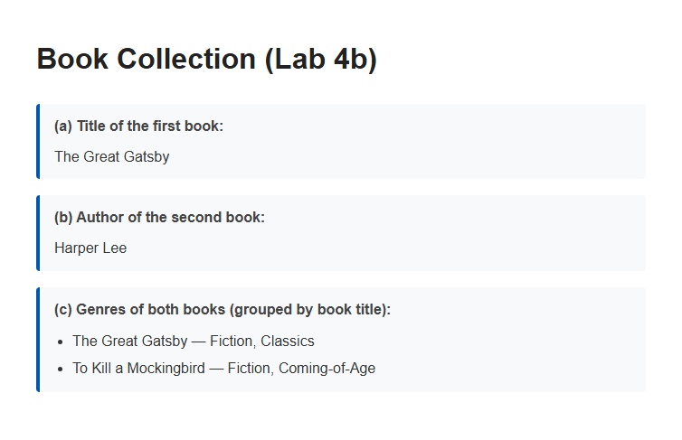
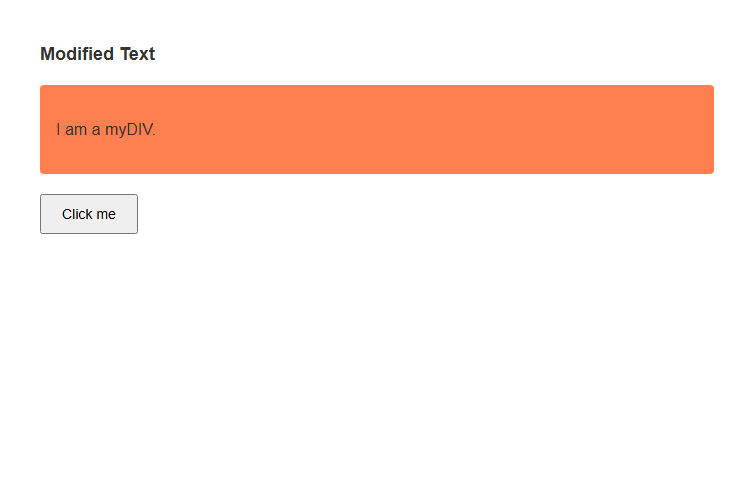

Name: NG LING NA

Student ID: AI240142

Course: BIC21203 Web Development


# Lab #4b: Asynchronous JavaScript (JSON & Fetch API) and jQuery DOM Manipulation

This repository contains solutions for Lab #4b. The lab focuses on working with structured data using JSON, fetching and parsing remote resources asynchronously using the native `fetch()` API, and performing DOM manipulation and event handling using jQuery 4.0.0.


## How to Run?

### Prerequisites
1. Any modern web browser (Google Chrome, Microsoft Edge).
2. A local HTTP server (such as XAMPP Apache, VS Code Live Server, or Python's `http.server`) to test the `fetch()` API for `books.json` without CORS/file-protocol restrictions.

### Instructions
1. Clone this repository:
   ```bash
   git clone https://github.com/lingnaa/bic21203-lab4b-json-jquery.git
   ```
2. Place the `Lab4b` folder under your local server root (e.g., `C:/xampp/htdocs/WebDev/Lab4b/`).
3. Start Apache from the XAMPP Control Panel, then open in your web browser:
   - `http://localhost/WebDev/Lab4b/books.html`
   - `http://localhost/WebDev/Lab4b/jquery-dom.html`
4. Alternatively, run a local server inside the `Lab4b` folder:
   ```bash
   python -m http.server 8000
   ```
   and open `http://localhost:8000/books.html` and `http://localhost:8000/jquery-dom.html`.


## Implementation Details and Output Evidence

---

### Task 1: Book Collection (`books.json`, `books.html`, `books.js`)

- **books.json**: Contains a top-level `"books"` array with two book objects (`title`, `author`, `publicationYear`, `genres`) adhering strictly to standard JSON specifications without trailing commas.
- **books.html & books.js**:
  - Uses the native asynchronous `fetch()` API to retrieve and parse `books.json`.
  - Safely renders elements using `textContent` and `document.createElement("li")` with zero `innerHTML`.
  - Displays:
    - (a) Title of the first book: **The Great Gatsby**
    - (b) Author of the second book: **Harper Lee**
    - (c) Genres grouped by book title:
      - **The Great Gatsby — Fiction, Classics**
      - **To Kill a Mockingbird — Fiction, Coming-of-Age**
  - Includes error handling for network errors (`!response.ok`) or invalid JSON format, rendering a user-friendly status banner.

**Output Evidence:**


---

### Task 2: jQuery DOM Manipulation (`jquery-dom.html`, `jquery-dom.js`)

- Includes the official full build of **jQuery 4.0.0** via CDN (`https://code.jquery.com/jquery-4.0.0.min.js`).
- Implements jQuery equivalents for the three native JavaScript operations:
  1. `$("#myElement").text("Modified Text");` — Replaces text content using `.text()`.
  2. `$("#myDIV").addClass("myStyle");` — Dynamically adds CSS class using `.addClass()`.
  3. `$("#myButton").on("click", function() { alert("Button clicked!"); });` — Attaches click listener using `.on("click", ...)`.

**Output Evidence:**



## Conceptual Questions (For PDF Report)

### 1. One Advantage of Native JavaScript (Vanilla JS)
- **Zero Overhead & Optimal Performance**: Native JavaScript runs directly in the browser's V8/SpiderMonkey engine without requiring the browser to download, parse, and execute external third-party library files (~80KB). With modern ECMAScript standards and DOM APIs (`querySelector`, `classList`, `fetch`, `addEventListener`), native JS provides cleaner native performance, lower memory consumption, and eliminates third-party dependency vulnerabilities.

### 2. One Situation Where an Existing Project May Still Use jQuery
- **Maintenance of Legacy Codebases & Third-Party Plugin Ecosystems**: Large enterprise applications frequently depend on mature third-party jQuery plugins (e.g., complex legacy DataTables, datepickers, sliders, or older UI frameworks like Bootstrap 3/4). Completely refactoring and testing these existing implementations into modern vanilla JS would introduce high costs, long turnaround times, and risks of regression bugs. Keeping jQuery maintains backward compatibility with minimal overhead.
